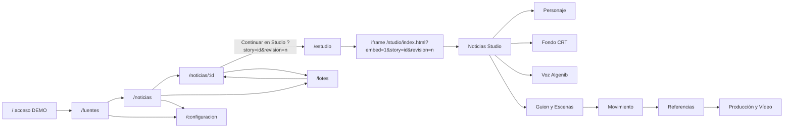

# Mapa de navegación observado

Entorno observado: `https://desktop-hta6ms6.tailf8096f.ts.net:8443`, sesión DEMO, 29-10-2026. Capturas de viewport reales en `CAPTURAS/`; las pantallas de carga se conservan junto a las cargadas para distinguir estados transitorios. No se inspeccionaron rutas ocultas o administrativas que no aparecen en la navegación.

| Ruta o sección | Acceso real | Pantalla/función | Captura |
|---|---|---|---|
| `/` | Entrada inicial | Ingreso en demo sin clave; no se probó inicio de sesión real | [00](CAPTURAS/00-acceso.png) |
| `/fuentes` | Cabecera | Alta URL/texto/archivo, lista, filtro, reanálisis | [01](CAPTURAS/01-fuentes.png), [18](CAPTURAS/18-fuentes-texto-formulario.png) |
| `/noticias` | Cabecera o fuente procesada | Vistas rápidas, filtros, tarjetas y acción siguiente | [02](CAPTURAS/02-noticias.png), [03](CAPTURAS/03-noticias-aprobadas.png), [21](CAPTURAS/21-noticia-ficticia-listado.png) |
| `/noticias/:id` | Tarjeta, lote | Resumen, afirmaciones/evidencias, versiones de guion, aprobación, storyboard | [04](CAPTURAS/04-noticia-detalle.png), [22](CAPTURAS/22-noticia-ficticia-detalle.png), [27](CAPTURAS/27-noticia-ficticia-storyboard.png) |
| `/lotes` | Cabecera o noticia | Lote 5/10, estados, bloqueos, orden, ZIP | [14](CAPTURAS/14-lotes.png), [15](CAPTURAS/15-lote-detalle.png), [16](CAPTURAS/16-lote-preparado.png) |
| `/configuracion` | Cabecera | Proveedores, modo demo, presupuestos y pesos | [17](CAPTURAS/17-configuracion.png) |
| `/estudio` | Cabecera o noticia aprobada | Contenedor del segundo frontend; muestra id y revisión en URL | [05](CAPTURAS/05-estudio-trapaso.png), [30](CAPTURAS/30-studio-prueba-importada.png) |
| Studio → Noticias | Menú interno | Redacción duplicada; importación automática del traspaso, botón «Producir en Vídeo» para activar la noticia | [30](CAPTURAS/30-studio-prueba-importada.png), [31](CAPTURAS/31-studio-prueba-activa.png) |
| Studio → Personaje | Menú interno | Ficha, hoja maestra, prompt, selección/solicitud de imagen | [06](CAPTURAS/06-studio-personaje.png) |
| Studio → Fondo CRT | Menú interno | Presets 16:9/9:16 y galería | [07](CAPTURAS/07-studio-fondo-crt.png) |
| Studio → Voz Algenib | Menú interno | Perfil y cadencia, sin TTS acoplado | [08](CAPTURAS/08-studio-voz.png) |
| Studio → Guion y Escenas | Menú interno o «Producir en Vídeo» | Guion continuo, desglose editable, envío a producción | [09](CAPTURAS/09-studio-guion-escenas.png), [32](CAPTURAS/32-studio-editar-escena.png) |
| Studio → Movimiento | Menú interno | Movimientos y prompts ópticos | [10](CAPTURAS/10-studio-movimiento.png) |
| Studio → Referencias | Menú interno | Referencias audiovisuales/editoriales | [11](CAPTURAS/11-studio-referencias.png), [12](CAPTURAS/12-studio-referencias-editoriales.png) |
| Studio → Producción y Vídeo | Menú interno o «Enviar a Producción» | Plan, prompts, controles de render, composición simulada y exportes técnicos | [13](CAPTURAS/13-studio-produccion.png), [34](CAPTURAS/34-studio-plan-ficticio-creado.png), [36](CAPTURAS/36-studio-composicion-accion.png) |

## Recorrido real de la noticia ficticia de auditoría

`Fuentes: texto ficticio` → trabajo de fuente #185 → candidata #12 → investigación #186 (0/4 afirmaciones con evidencia) → borrador #187 (98 palabras, v1) → storyboard editorial (5 escenas) → aprobación interna DEMO del guion v1 → `/estudio?story=12&revision=1` → importación `production_handoff.v1` → **acción adicional «Producir en Vídeo»** → 5 escenas Studio → plan v1 local → composición FFmpeg en estado `QUEUED` en la última observación. No se autorizó generación de pago, publicación ni se confirmó MP4 final.

El enlace a Studio **importa**, pero no activa automáticamente esa noticia para producción: antes de pulsar «Producir en Vídeo», Guion y Producción muestran la pieza de ejemplo inicial. Esa acción extra no se explica en el enlace de origen. El `iframe` comparte host con la web, pero conserva otro árbol React, otra navegación y estados propios.

## Cobertura visual y limitaciones

Hay 42 PNG de pantallas y estados observados. Se capturaron las rutas principales, las ocho secciones de Studio y los principales estados de la prueba ficticia. Las capturas son de viewport de escritorio y algunas pantallas largas continúan bajo el pliegue; no se dispone de una serie móvil capturada durante esta sesión. El navegador registró **0 mensajes `error`/`warn` de consola** en el flujo observado. La herramienta de navegador no expuso una traza HTTP con códigos por solicitud; por tanto no se declara que toda la red carezca de errores.
