# Propuesta para un único flujo de trabajo

Documento de decisión; **no se ha implementado**. La meta es una sola aplicación y una sola verdad editorial, no mantener dos redacciones conectadas por un traspaso.

## Recorrido propuesto

```mermaid
flowchart LR
  F["1 Fuentes e investigación"] --> V["2 Evidencia y verificación"]
  V --> S["3 Selección editorial"]
  S --> G["4 Guion IA + edición + aprobación"]
  G --> E["5 Escaleta y storyboard"]
  E --> A["6 Recursos: originales / archivo / IA / B-roll"]
  A --> P["7 Producción NeuralDotAI"]
  P --> M["8 Montaje + pista de voz"]
  M --> R["9 Revisión factual y audiovisual"]
  R --> X["10 Exportación trazable"]
```

El objeto de trabajo sería **una noticia/pieza** con un ID estable, revisión de guion aprobada, afirmaciones y evidencias, escenas, recursos con procedencia, perfil audiovisual, trabajos de generación, montaje, revisión y exportes. La misma ficha debería abrir cada fase sin volver a importar datos ni duplicar estados. El lote sería una agrupación opcional de piezas, no otra redacción.

## Decisiones de conservación y fusión a revisar

| Decisión | Base reutilizable | Qué habría que resolver antes de ejecutarla |
|---|---|---|
| Mantener `apps/api` como núcleo de datos y trabajos | Modelos, estados, evidencia, aprobación, presupuesto, cola, contratos y FFmpeg | Persistencia de escenas/recursos/planes, permisos y estados de revisión final |
| Mantener `apps/web` como un solo frontend | Shell, rutas, formularios y fichas | Convertir secciones útiles de Studio en componentes/rutas del mismo frontend; retirar `iframe` solo al terminar migración |
| Incorporar las utilidades de Studio | `scriptAnalyzer.ts`, `productionProject.ts`, `avProfiles.ts`, referencias y catálogo de movimientos | Unificar tipos, fuentes de verdad y duraciones; usar el ratio elegido en todo el flujo |
| Retirar la redacción paralela de Studio | Handoff import y `NewsEditorialTab.tsx` solo como guía de funcionalidades | Migrar primero bloques, filtros o editor que aporten valor; conservar historial/importaciones existentes |
| Conservar un solo estado de aprobación | `scripts.py`, `editorial_status.py`, hash de guion | Añadir decisión explícita para aprobar con verificación pendiente y bloqueo/aviso de publicación |
| Unificar storyboard, escaleta y plan | `image_prompt.py`, `ScriptTab`, `ProductionPlanPanel` | Un esquema de escena: texto, afirmación vinculada, duración, plano, transición, prompts, recursos y estado |
| Crear gestión de recursos | Biblioteca de referencias de Studio + evidencia de neural.news | Distinguir vídeo/foto original, archivo licenciado, ilustración IA y recurso simulado; registrar autor, licencia, fuente, hash y aprobación |
| Añadir B-roll informativo | No se halló implementación especializada | Definir qué dato explica cada recurso, su fuente y restricción visual; evitar usar imágenes decorativas como prueba factual |
| Unificar voz y montaje | Perfil Algenib y FFmpeg local | TTS/pista master si se decide, sincronización por escena, control de subtítulos y revisión de cortes; no declarar voz real hasta integrarla |
| Definir generación real como adaptadores | `Flow.generate.image/video`, presupuestos API | Validar SDK, credenciales, costes, licencias, salida y consentimiento; mantener demo claramente separado |
| Consolidar exportación | ZIP editorial y JSON/MP4 Studio | Paquete final con revisión aprobada, manifiesto, procedencia de medios, guion, storyboard, MP4 y avisos |

## Navegación mínima candidata

1. **Bandeja**: fuentes, candidatas y piezas con estado y siguiente acción real.
2. **Pieza**: pestañas internas Evidencia → Guion → Escenas → Recursos → Producción → Revisión; encabezado único con estado, versión y bloqueos.
3. **Biblioteca**: referencias canónicas y recursos audiovisuales con procedencia.
4. **Lotes/Exportes**: agrupación opcional y paquetes.
5. **Configuración**: proveedores, identidad editorial y límites de gasto.

Esto sustituiría las dos «Noticias» y la secuencia de ocho pestañas de Studio por una ficha de pieza. El cambio de arquitectura debe decidirse antes de mover código, porque la migración ha de preservar datos y revisiones ya existentes.

## Puertas de aceptación para una futura implementación

- Abrir una candidata y avanzar hasta exportación sin introducir el mismo guion/fuente en otro módulo ni usar `iframe` o importar JSON manualmente.
- Cada afirmación relevante muestra estado y evidencia; la aprobación con huecos exige motivo visible y la revisión final los conserva.
- Cada escena conserva la revisión exacta de guion, tiene duración válida para el proveedor elegido y muestra el medio concreto con su procedencia.
- Perfil NeuralDotAI, plató, ratio y voz se aplican de forma coherente a storyboard, prompts, producción y exportación; los activos reales se distinguen de descripciones textuales.
- El montaje usa medios aprobados y una pista de voz verificable; un MP4 de colores y tonos se identifica como simulación.
- El usuario puede corregir guion, escenas, recursos y montaje; las correcciones invalidan solo las aprobaciones afectadas.
- El paquete exportado permite reconstruir qué versión, evidencias, medios y decisiones produjeron el vídeo.

Ningún módulo se elimina en esta revisión. La propuesta indica candidatos y condiciones para una decisión conjunta posterior.
